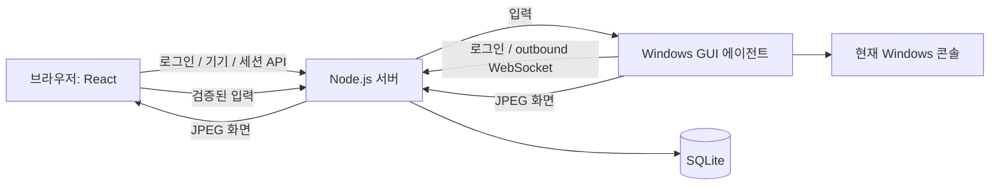
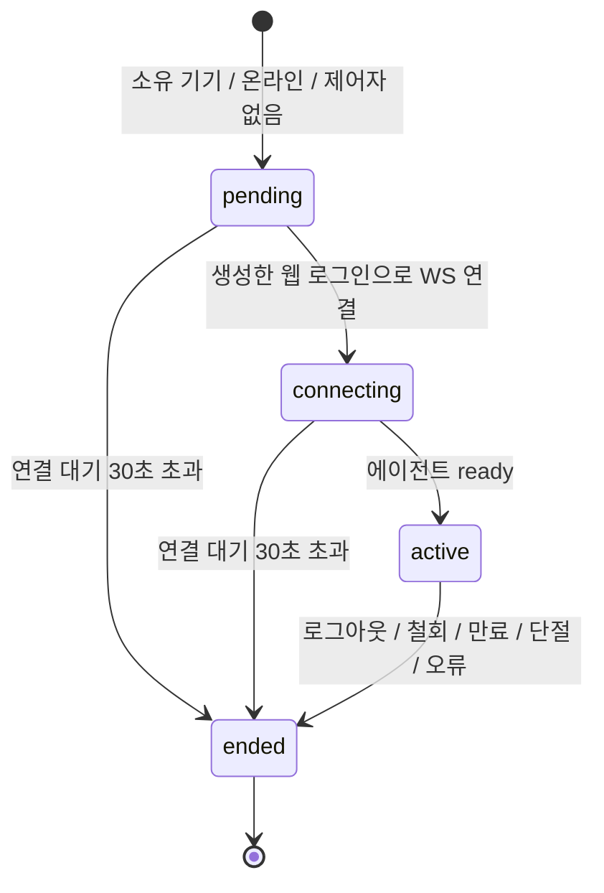

# MVP 아키텍처

2026-10-15 / 애플리케이션 0.1.0 / 결정 D-006~010. 구현 사실과 향후 제안을 구분한다.

## 구성

웹/API/중계를 가진 Node 서버 1개와 각 Windows의 대화형 에이전트로 구성한다. Vite 빌드 결과를 같은 서버에서 제공해 쿠키/Origin 경계를 단순화한다. 별도 Vite dev 서버는 없다. `Hub`는 활성 WebSocket을, SQLite는 영속 소유권과 기록을 관리한다.

서버는 화면·입력 데이터에 접근할 수 있는 신뢰 주체다. 화면 녹화, 입력 내용 로그, 클립보드 조회를 기본 수집하지 않는다. P2P/종단 간 암호화는 미구현이다. HTTPS/WSS 두 구간의 TLS와 종단 간 암호화는 구분한다.

## 로그인과 기기 등록

1. 운영자가 로컬 CLI로 사용자를 생성한다. 공개 회원가입/기본 비밀번호는 없다.
2. 웹에는 256비트 난수 세션 쿠키를 발급한다. HttpOnly, SameSite=Strict, Path=/; HTTPS에서 Secure. 서버에는 SHA-256 해시만 저장한다. 쓰기 API는 정확한 Origin과 로그인별 CSRF 토큰을 요구한다.
3. 에이전트는 같은 계정으로 별도 네이티브 API에 로그인한다. Origin이 있는 요청은 거부한다. Bearer는 메모리에만 저장하고 비밀번호를 재접속에 사용하지 않는다.
4. `%LOCALAPPDATA%/DeskLink/installation-id`에는 랜덤 설치 ID만 저장한다. 계정+설치 ID가 같으면 동일 기기를 갱신한다. 로그인만으로 온라인이 되지 않고 인증된 agent WS가 열려야 한다.
5. 같은 기기의 재로그인은 이전 토큰과 연결을 철회한다. 웹 8시간, agent 12시간이며 자동 연장하지 않는다.

모든 사용자 권한은 자기 기기 제어로 동일하다. 조직/RBAC/공유 초대는 후속 범위다. 앱 로그인과 Windows 로그인은 다르다. 에이전트는 **Windows에 로그인한 대화형 사용자 세션에서 실행**되며 앱 로그인과 원격 허용 동작도 필요하다.

## 원격 세션

DB 부분 유일 인덱스로 기기당 미종료 세션 하나만 허용한다. viewer는 생성에 사용한 **웹 로그인 해시**에 귀속되어 같은 계정의 다른 로그인으로도 가로챌 수 없다. attach는 1회만 허용한다. 세션 ID만으로 접근할 수 없으며 최대 원격 시간은 30분이다.

양쪽 WS에 15초 ping을 보내고 다음 점검까지 응답이 없으면 종료한다. 무응답 감지는 정상 이벤트 루프에서 최대 약 30초. 인증/원격 시간 만료는 1초마다 검사하고 메시지 처리 시에도 인증을 확인한다. TCP가 즉시 닫히면 바로 종료한다. 에이전트의 일시적 장애는 1→2→4→8→15초 지연으로 재접속하지만 끝난 원격 세션을 자동 부활시키지 않는다.

웹 로그아웃은 해당 웹 로그인 세션을 종료한다. 에이전트 로그아웃/종료/철회는 해당 기기 원격 세션과 agent 인증을 종료한다. 브라우저 포커스/가시성 상실 시 `release`를 전송하고 에이전트는 stop/단절 시 추적한 키·버튼을 해제한다. 네트워크 지연 중 이미 전달된 입력은 취소할 수 없다.

## Windows 캡처·입력

0.1.1에서는 협상된 입력 복구 기능을 사용한다. Windows 입력 거부 시 화면은 유지하고 agent/서버/웹에서 추가 입력을 막는다. 사용자의 명시적 재시도 후 재개하며, 실패한 입력은 자동 재전송하지 않는다. 잠금·캡처·규약 오류는 계속 종료한다. 세부 규약은 protocol.md 참고.

- 기본 모니터를 `Graphics.CopyFromScreen`으로 캡처하고 비율을 유지하여 최대 1600×900, JPEG quality 55로 만든다. 200ms 간격(목표 5 FPS); CPU/네트워크에 따라 낮아질 수 있다.
- 캡처는 원격 세션 동안만 동작한다. 입력 데스크톱 이름이 `Default`인지 읽어 잠금/UAC 등 접근 불가능한 화면은 실패로 처리한다. 보안 데스크톱으로 전환하거나 권한을 올리지 않는다.
- 2 MiB/frame, 초당 15 frame 상한, 전송 대기량 제한을 적용한다. 느린 viewer에는 frame을 버려 지연을 줄인다. 원본 화면을 저장하지 않는다.
- 마우스 좌표 0~1을 실제 기본 화면 좌표로 변환한다. `SendInput`으로 버튼/휠/키/UTF-16 Unicode를 전달한다. 창 포커스는 사용자가 원격 화면에서 지정한다.
- 한글은 로컬에서 조합한 완성 문자열 경로를 제공한다. composition 중 물리 키는 보내지 않는다. 한영 버튼은 VK_HANGUL을 보내며 호스트 IME 상태를 읽었다고 표시하지 않는다.
- 관리자 앱/UAC, 브라우저가 가로채는 단축키, 게임, 터미널별 Unicode는 보장하지 않는다. SendInput은 같은/낮은 무결성 앱에만 적용된다.
- 마우스 커서는 JPEG에 합성하지 않는다. 웹 커서로 포인팅하며 서버 커서 동기화는 후속 작업이다. 터치는 단일 포인터 탭/드래그까지 구현했고 두 손가락 스크롤은 후속 범위다.

## 데이터와 복구

| 테이블 | 보관 내용 | 경계 |
|---|---|---|
| users | ID, 정규화 계정, 이름, salt+scrypt 해시 | 운영자 CLI 생성 |
| devices | 소유자, 설치 ID, 이름/버전, 마지막 접속 | 소유자+설치 ID 유일 |
| auth_sessions | 토큰 해시, 종류, 소유자, 기기, CSRF, 만료 | 만료 항목 주기적 제거 |
| remote_sessions | 생성 로그인 해시, 기기, 상태, 시간, 종료 사유 | 서버 재시작 시 미종료 기록 종료 |
| audit_events | 소유자, 기기, 고정 이벤트 코드, 시간 | 입력/화면/토큰 미수집 |

SQLite `user_version=1`, WAL, foreign keys, prepared statements를 사용한다. 초기 스키마는 `server/store.ts`에 있다. 다음 변경부터 명시적 버전 마이그레이션을 추가한다. 최신 DB를 구버전 코드로 열면 거부한다. CLI는 원격 세션을 초기화하지 않는다. 서버 재시작 정리는 `createApplication`에서만 한다.

단일 서버/SQLite 구성이다. 여러 프로세스를 같은 DB로 운영하지 않는다. 일관된 백업은 서버를 정상 종료한 뒤 DB를 개인 백업 대상으로 복사한다. 감사/세션 보존·삭제, DB 암호화, 다중 서버 presence/rate limit는 운영 전 추가 작업이다.

## 외부 접속 조건

기본은 loopback 개발용. 외부에서는 신뢰하는 reverse proxy가 TLS를 종료하고 HTTP/WS를 전달해야 한다. `PUBLIC_ORIGIN=https://정확한호스트`, 앱 바인딩 포트 비공개, proxy도 loopback에서 연결할 때만 `TRUST_PROXY=1`을 사용한다. proxy는 WS upgrade와 원래 Origin을 보존해야 한다.

proxy가 다른 호스트라면 현재 loopback 신뢰 정책을 별도 변경·검토한다. 비밀번호/토큰을 URL이나 액세스 로그에 넣지 않는다. MFA, 계정 수명주기, 인증서/서명, 대역폭 제한을 갖춘 뒤 외부 공개를 결정한다. 실제 운영 배포는 이번 작업에 포함하지 않았다.
